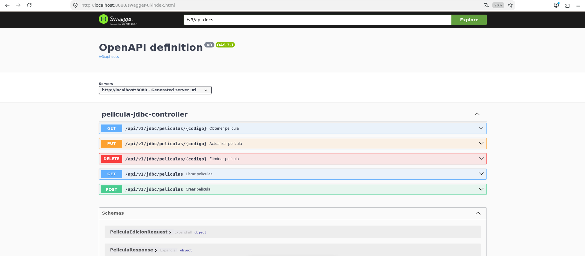

# Servicio REST de películas

## 1. Descripción

La aplicación ofrece una API REST para gestionar películas mediante Spring Boot, JDBC y SQLite3.

La ruta base es:

`/api/v1/jdbc/peliculas`

## 2. Operaciones disponibles

| Método | Ruta | Descripción | Respuestas |
|---|---|---|---|
| GET | `/api/v1/jdbc/peliculas` | Listar películas | 200 |
| GET | `/api/v1/jdbc/peliculas/{codigo}` | Obtener una película | 200, 404 |
| POST | `/api/v1/jdbc/peliculas` | Crear una película | 201, 400, 409 |
| PUT | `/api/v1/jdbc/peliculas/{codigo}` | Actualizar una película | 200, 400, 404 |
| DELETE | `/api/v1/jdbc/peliculas/{codigo}` | Eliminar una película | 204, 404 |

## 3. Flujo de datos: creación de una película

Al realizar una petición POST, el JSON recibido contiene los campos:

- `codigo`
- `titulo`
- `anioEstreno`
- `duracionMinutos`

El flujo atraviesa las siguientes capas:

1. **API:** `PeliculaRequest` recibe y valida los datos.
2. **Mapper de API:** `PeliculaApiMapper.aDatosCreacion()` transforma la petición en `DatosCreacionPelicula`.
3. **Servicio:** `PeliculaService` gestiona la creación.
4. **Mapper de dominio:** `PeliculaDominioMapper.aPelicula()` transforma los datos en el objeto `Pelicula`.
5. **Repositorio:** `PeliculaJdbcRepository` realiza la operación de persistencia.
6. **Mapper de entidad:** `PeliculaEntityMapper.aEntity()` transforma el objeto de dominio en `PeliculaEntity`.
7. **Base de datos:** JDBC guarda los datos en SQLite3.

## 4. Flujo de datos: consulta por código

Al realizar una petición GET con un código:

1. El controlador recibe el código solicitado.
2. El servicio solicita la película al repositorio.
3. El repositorio consulta SQLite3 mediante JDBC.
4. `PeliculaRowMapper` transforma el resultado SQL en `PeliculaEntity`.
5. `PeliculaEntityMapper` transforma la entidad en el objeto de dominio `Pelicula`.
6. `PeliculaApiMapper.aRespuesta()` transforma el objeto en `PeliculaResponse`.
7. El controlador devuelve la respuesta JSON.

## 5. Correspondencia de campos

| JSON de la API | Modelo de dominio | Columna SQLite |
|---|---|---|
| `codigo` | `identificador` | `pelicula_codigo` |
| `titulo` | `nombre` | `titulo_texto` |
| `anioEstreno` | `anioLanzamiento` | `estreno_anio` |
| `duracionMinutos` | `minutosProyeccion` | `duracion_minutos` |

## 6. Códigos HTTP

- **200 OK:** consulta o actualización realizada correctamente.
- **201 Created:** película creada correctamente.
- **204 No Content:** película eliminada correctamente.
- **400 Bad Request:** los datos enviados no superan la validación.
- **404 Not Found:** no existe una película con el código solicitado.
- **409 Conflict:** ya existe una película con el código indicado.

Los errores incluyen una respuesta `ProblemDetail` con información sobre el problema.

## 7. Documentación Swagger

La API dispone de documentación OpenAPI accesible desde Swagger UI:

`http://localhost:8080/swagger-ui/index.html`

En ella se pueden consultar las cinco operaciones, sus parámetros, cuerpos de petición y respuestas HTTP.

